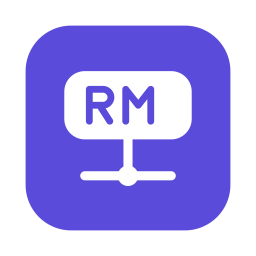
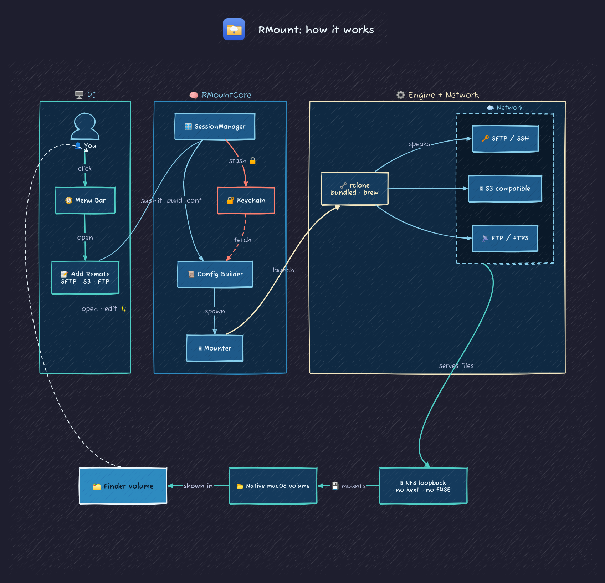

<div align="center">



# RMount

**Mount SFTP, S3, FTP, SMB, WebDAV/Nextcloud servers and Google Drive as native macOS volumes.**
No macFUSE. No kernel extensions. No security prompts.

[](https://github.com/fperdigon/rmount/actions/workflows/ci.yml)
[](https://github.com/fperdigon/rmount/releases/latest)
[](https://github.com/fperdigon/rmount/releases)
[](LICENSE)


[](https://github.com/fperdigon/rmount/commits/main)

[Download](https://github.com/fperdigon/rmount/releases) ·
[Install](#install) ·
[Highlights](#highlights) ·
[Credits](#credits)

</div>

---

## What it does

<p align="center">
  
</p>

Your remote files, in Finder. Open, edit, drag, like any folder on your Mac.

RMount lives in the menu bar. For each remote it starts a small local
[rclone](https://rclone.org) server and mounts it with macOS's own network-volume support,
so nothing needs to be installed in the kernel.

## Highlights

- **SFTP / SSH**: password, existing key file, or generate a new key in-app.
- **S3-compatible**: AWS, Cloudflare R2, Backblaze B2, Wasabi, MinIO, DigitalOcean Spaces, custom endpoints.
- **FTP / FTPS**: explicit or implicit TLS.
- **WebDAV / Nextcloud / ownCloud**: URL, user and (app) password.
- **SMB / Windows shares**: NAS, Samba and Windows shares by host, user, password and share name.
- **Azure Blob, Backblaze B2, Google Cloud Storage**: by account key / application key / service-account JSON; the container or bucket is the first path component.
- **Other rclone backend**: any rclone backend type with `name = value` options; secret options are kept in the Keychain, never in a file.
- **Google Drive**: browser sign-in; optional shared drive, root folder and your own OAuth client.
- **Import from `rclone.conf`**: bring your existing remotes with you.
- **Per-remote performance settings**: cache mode, read-ahead, buffer size, write-back delay.
- **Live updates**: changes on the server show up in seconds.
- **Auto-mount at login.**
- **Passwords stored in your Keychain**, never on disk in plaintext.

## How it works

<p align="center">
  
</p>

## Install

### Homebrew

```bash
brew install --cask fperdigon/rmount/rmount
```

Use `fperdigon/rmount/rmount-lite` for the lite flavour (it installs rclone for you). The cask clears the
Gatekeeper flag after installing, so the app opens without the prompt below. The tap is
[fperdigon/homebrew-rmount](https://github.com/fperdigon/homebrew-rmount).

### Download

Or pick one DMG from the [latest release](https://github.com/fperdigon/rmount/releases) and drag
the app to `/Applications`.

The apps are signed ad hoc but not notarized (no Apple Developer ID yet), so the first launch
asks you to confirm: **right-click the app and choose Open**, or open *System Settings ->
Privacy & Security* and click **Open Anyway**. Or run the matching command **once** to clear
macOS's Gatekeeper flag:

```bash
# if you installed rmount
xattr -dr com.apple.quarantine /Applications/rmount.app

# if you installed rmount-lite
xattr -dr com.apple.quarantine /Applications/rmount-lite.app
```

If you see *"rmount is damaged and can't be opened"*, that is Gatekeeper rejecting an app whose
signature does not match its contents (older builds, before this was fixed), not corruption of
your download: the command above gets past it.

Launch the app. A small icon appears in your menu bar; click it to add your first remote.

### Two flavours

|              | `rmount`                | `rmount-lite`                     |
| ------------ | ----------------------- | --------------------------------- |
| **DMG size** | ~32 MB                  | ~800 KB                           |
| **rclone**   | bundled inside the app  | uses your `brew install rclone`   |
| **Best for** | "just works" install    | smaller download / power users    |

Pick one. They can coexist if you want both.

### Coming from macsh?

Install RMount from the [latest release](https://github.com/fperdigon/rmount/releases). Updating macsh from inside the app no
longer works, because releases no longer carry `macsh-*` files.
Your remotes, passwords and settings are carried over automatically, and the old data is left
untouched. Re-enable *Launch at login* in Settings afterwards.

### Updates

RMount checks GitHub for a new version about once a day and offers to install it
(Settings -> Updates, or "Check for updates..." in the menu). Choose **Stable releases**
(tagged `vX.Y.Z`) or **Nightly builds** (one per commit on `main`). The download is verified
against its published SHA-256, then the app is replaced in place and relaunched. RMount must be
installed in a folder you can write to (normally `/Applications`).

## Requirements

- macOS **14 (Sonoma)** or later
- Apple Silicon (M-series). Intel is not supported.

## Build from source

macOS only (Security, NetFS and SwiftUI do not exist elsewhere).

```bash
swift build
swift test                      # unit tests; integration tests skip themselves
./scripts/build-release.sh      # builds both apps and DMGs into dist/ (needs xcodegen)
```

Read [AGENTS.md](AGENTS.md) before changing code: it covers the layout, the testing rules and
what CI expects.

## Credits

RMount is a fork of **[macsh](https://github.com/AyonPal/macsh)**, created by
**[Ayon Pal](https://github.com/AyonPal)** and released under the Apache License 2.0.
The original design, the rclone-based architecture and the first versions of the app are his
work, and the git history of this repository keeps his commits. Many thanks to Ayon.

Mounting is done by [rclone](https://rclone.org) (MIT licensed), which RMount bundles in the
full flavour. See [NOTICE](NOTICE) and [CONTRIBUTORS.md](CONTRIBUTORS.md) for details.

Maintained by [Francisco Perdigon Romero](https://github.com/fperdigon), founder of [Core AI](https://core-ai.net), a company specializing in privacy-focused enterprise AI solutions.
Fixes that are useful to the original project are also offered back upstream.

## Contributing

Bug reports and pull requests are welcome. Especially useful right now:

- Code signing and notarization (needs an Apple Developer ID).
- Additional backends.
- Testing on real providers and NAS devices.

## Contributors

<table>
  <tr>
    <td align="center"><a href="https://github.com/AyonPal"><br><sub><b>Ayon Pal</b></sub></a><br><sub>original macsh author</sub></td>
    <td align="center"><a href="https://github.com/fperdigon"><br><sub><b>Francisco Perdigon Romero</b></sub></a><br><sub>RMount maintainer</sub></td>
  </tr>
</table>

Who wrote how much: [CONTRIBUTORS.md](CONTRIBUTORS.md#who-wrote-the-code).

## License

[Apache License 2.0](LICENSE). Copyright 2026 Ayon Pal (original macsh) and RMount contributors.
